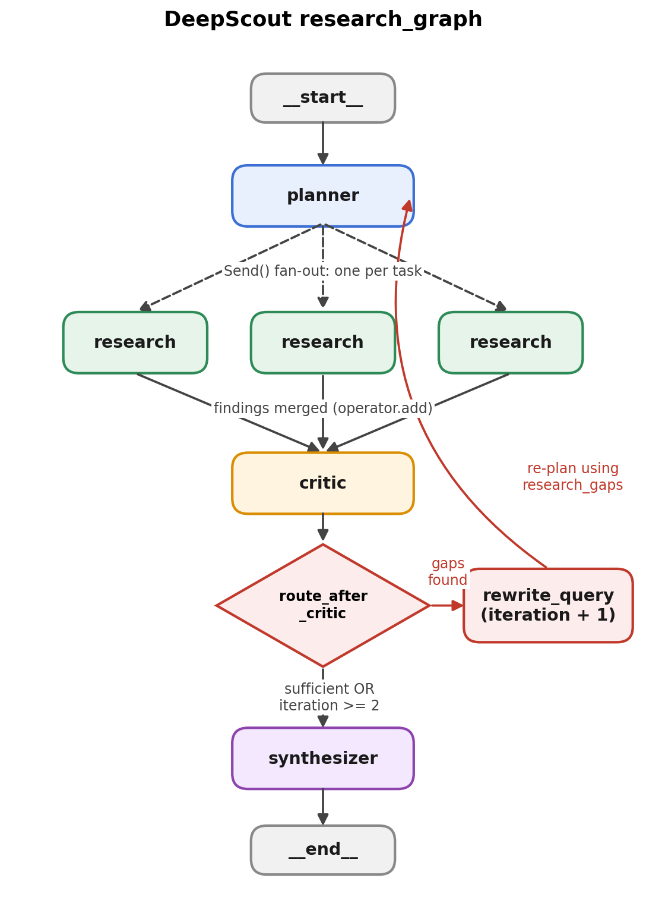

# DeepScout — Multi-Agent Research System

DeepScout is a LangGraph-powered, multi-agent research system that transforms a research question into a structured, source-backed report.

Instead of relying on a single LLM response, DeepScout uses a coordinated workflow of specialized agents to plan research, gather information from multiple sources, evaluate findings, identify knowledge gaps, and iteratively improve the final report.

## Architecture



## How It Works

DeepScout follows an iterative research pipeline designed to improve the completeness and quality of its reports.

1. **Planning** — The Planner Agent breaks the user's research topic into focused sub-questions and creates a research plan.
2. **Parallel Research** — Multiple Researcher Agents investigate different sub-questions concurrently using web search.
3. **Criticism & Evaluation** — The Critic Agent evaluates the collected findings, identifies missing information, and determines whether the research is sufficient.
4. **Iterative Refinement** — If important gaps remain, the system performs additional research targeting those gaps. The workflow can repeat until the research is sufficiently complete.
5. **Report Synthesis** — The Synthesizer Agent combines the research findings into a coherent, structured Markdown report with supporting sources.

## Key Features

- **Multi-Agent Architecture:** Specialized agents collaborate to conduct and synthesize research.
- **Parallel Research:** Independent research tasks can be executed concurrently.
- **Iterative Research:** Critic-driven feedback helps identify and address information gaps.
- **Source-Backed Reports:** Research findings retain source references to support the generated report.
- **Structured Output:** Research is presented as a readable Markdown report.
- **Graph-Based Orchestration:** LangGraph manages the workflow, state transitions, and iterative execution.
- **Authenticated Research Sessions:** Users can create and access their research through the application's authenticated interface.

## Tech Stack

| Component | Technology |
|---|---|
| Agent Orchestration | LangGraph |
| LLM | OpenAI GPT-4o-mini |
| Backend | FastAPI, Python |
| Web Search | Tavily Search |
| Frontend | Next.js, React, TypeScript |
| Report Format | Markdown |

## Project Structure

```text
DeepScout/
├── Backend/
│   └── ...                 # FastAPI backend and research graph
├── frontend/
│   └── ...                 # Next.js application
├── deepscout_graph.png     # Research workflow diagram
└── README.md
```

> Adjust the `Backend/` and `frontend/` paths above if your actual folder names differ.

## Getting Started

### Prerequisites

- Python 3.10+
- Node.js and npm
- OpenAI API key
- Tavily API key
- PostgreSQL database (if required by your backend configuration)

### 1. Clone the Repository

```bash
git clone <your-repository-url>
cd DeepScout
```

### 2. Configure the Backend

Navigate to your backend directory and install the dependencies:

```bash
cd Backend
pip install -r requirements.txt
```

Create a `.env` file in the backend directory and configure the required environment variables:

```env
OPENAI_API_KEY=your_openai_api_key
TAVILY_API_KEY=your_tavily_api_key
DATABASE_URL=your_database_url
```

Use the actual variable names expected by your application. Add any other required configuration, such as authentication secrets.

Start the FastAPI server:

```bash
uvicorn main:app --reload
```

Replace `main:app` with your actual FastAPI application entry point if it differs.

### 3. Configure the Frontend

Open a separate terminal:

```bash
cd frontend
npm install
```

Configure the frontend environment variables according to your application's API configuration.

Start the development server:

```bash
npm run dev
```

Open the local URL displayed by Next.js, typically:

```text
http://localhost:3000
```

## Example Use Case

**Research question:**

> How are multi-agent AI systems being used to automate software development, and what are their limitations?

DeepScout can decompose the question into smaller research tasks, investigate each task in parallel, evaluate the collected evidence, research unresolved gaps, and synthesize the results into a structured report.

## Future Improvements

- Add stronger source-quality and credibility evaluation.
- Improve research stopping criteria and iteration limits.
- Support report export to PDF and other formats.
- Introduce user-configurable research depth and scope.
- Add richer tracing, observability, and evaluation of agent performance.

## Author

Developed as a personal project exploring multi-agent systems, agentic workflows, and reliable AI-powered research.

---

**DeepScout** — From research questions to structured, evidence-backed insights.
